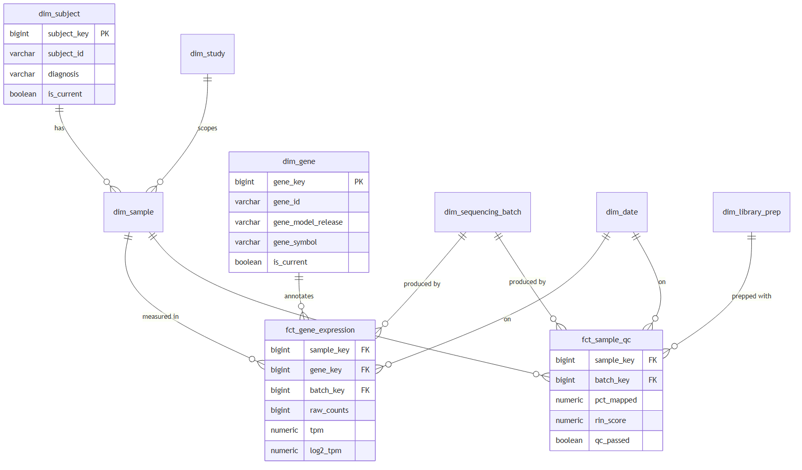
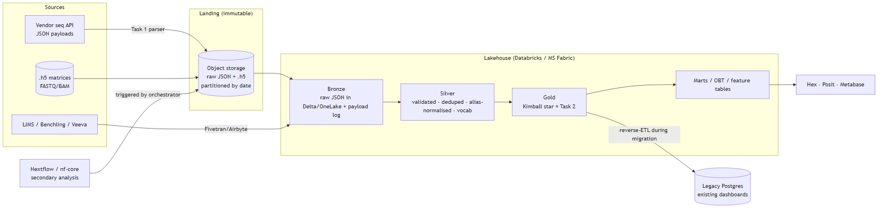

# RNA-seq Ingestion Pipeline

Production-grade ingestion of sequencing-vendor JSON payloads into PostgreSQL: strict validation,
schema evolution, and idempotent loads, with design notes for an analytical star schema and a
target lakehouse platform.

[](https://github.com/mfalcesr/omics-engineering-rnaseq-ingestion-pipeline/actions/workflows/ci.yml)
[](pyproject.toml)
[](LICENSE)

---

## The scenario

A translational-genomics lab receives processed RNA-seq results from multiple sequencing vendors as
JSON. The vendors use slightly different field names, payloads are sometimes re-delivered (a
reprocessing with better data), and some arrive malformed. This project ingests them reliably into a
shared PostgreSQL database, and sketches the analytical model and platform the lab would grow into.

It is deliberately three layers:

| Layer | What | Status |
|---|---|---|
| **Pipeline** | `parse → validate → normalise → load` into PostgreSQL | **Implemented + tested** (25 tests) |
| **Analytical model** | Kimball star schema for cross-study analysis | Design ([docs/gold_star_schema.md](docs/gold_star_schema.md)) |
| **Platform** | target lakehouse architecture + migration | Design ([docs/target_platform.md](docs/target_platform.md)) |

---

## Highlights

- **Strict validation** (Pydantic v2): a vendor sending `total_reads` as the string `"52381204"` is
  *rejected*, not silently coerced; every error is reported at once with its exact JSON path.
- **Atomic, all-or-nothing writes:** a malformed payload is written to a dead-letter log and the
  database is left byte-identical.
- **Schema evolution without migrations:** the ~10 queried fields are typed columns; everything else
  lands in a GIN-indexed `JSONB` catch-all; the full raw payload is kept for audit. New vendor fields
  cost zero migrations.
- **Idempotent loads:** one current row per sample (`upsert-if-newer`), plus an append-only audit log,
  so re-running the same payload is a safe no-op and a genuine reprocessing updates in place.
- **Two assay types:** bulk and single-cell RNA-seq, with different QC metrics and null TPM
  (Transcripts Per Million) for single-cell, handled by one nullable model.
- **Legacy-safe:** additive migrations only, plus a `v_sample_legacy` view pinning the original column
  contract, so existing consumers never break.
- **Served, not just stored:** an async [read API](#read-api) (FastAPI) exposes the loaded data over
  HTTP with keyset pagination and auto-generated docs, connecting as a SELECT-only role so the write
  path and its idempotency guarantees stay untouched.
- **Tested:** 34 tests, 25 pure unit (no database) and 9 integration against real PostgreSQL, run in
  CI (Continuous Integration) via GitHub Actions.

The reasoning behind every choice is in [docs/DECISIONS.md](docs/DECISIONS.md).

---

## Pipeline shape

```
JSON ─▶ parse ─▶ validate ─▶ normalise ─▶ load ─▶ PostgreSQL ─▶ read API ─▶ HTTP
        └──── pure, no database ────┘    └ one transaction ┘   └ async, read-only ┘
             write path: `ingest` CLI, as rnaseq_user           read path: as rnaseq_api
```

The first three stages are pure functions (no database), so they test in milliseconds; only `load`
opens a transaction. The read path is a separate process with its own SELECT-only role, so serving
traffic can never interfere with the loader's idempotency guarantees.

---

## Design highlights

**Analytical model (Gold layer).** A Kimball star schema with two fact tables at different grains:
`fct_gene_expression` (one row per sample x gene) and `fct_sample_qc` (one row per sample), so a
quality query never scans the huge expression fact. `dim_gene` is versioned by gene-model release,
because expression is only comparable within one annotation version. Full write-up in
[docs/gold_star_schema.md](docs/gold_star_schema.md).



**Target platform.** A medallion lakehouse (Databricks or Microsoft Fabric) with an immutable raw
landing zone, a reverse-ETL sync back to the legacy database so existing dashboards survive migration,
and Nextflow kept for bioinformatics rather than rebuilt. Full write-up in
[docs/target_platform.md](docs/target_platform.md).



---

## Prerequisites

- Docker Desktop 20+ (`docker compose version`)
- Python 3.10+ (`python3 --version`; on Windows `py --version`)

---

## Quick start

```bash
# 1. Start PostgreSQL (schema + 5 baseline rows load automatically on first boot)
cp .env.example .env
docker compose up -d

# 2. Apply the additive, idempotent migration (safe to run repeatedly)
docker exec -i rnaseq-postgres psql -U rnaseq_user -d rnaseq_db < db/migrations/001_extend_sample.sql

# 3. Install  (add the `api` extra too if you want the read API: ".[api,dev]")
python3 -m venv .venv
.venv/bin/pip install -e ".[dev]"

# 4. Ingest every fixture
.venv/bin/ingest load-dir sources/vendor_payloads --console
#   ...or one payload:
.venv/bin/ingest load-payload sources/vendor_payloads/RNA-BULK-006.json --console
```

On Windows, use `py -m venv .venv` and the `.venv\Scripts\` path in place of `.venv/bin/`.

**Entry point:** `ingest load-payload <file>` / `ingest load-dir <dir>`. Exit code is non-zero if any
payload is rejected, so CI and orchestrators can detect failure. `--json-logs` (default) emits
structured JSON with `payload_id` on every line; `--console` is the readable variant.

---

## What a run looks like

From a clean database (5 baseline rows) after ingesting all five fixtures:

```
[LOADED   ] RNA-BULK-006.json            insert
[LOADED   ] RNA-BULK-006_duplicate.json  update (reprocessing supersedes: pct_mapped 94.7 → 94.9, tool 2.2.1 → 2.2.2)
[LOADED   ] RNA-BULK-007.json            insert (second vendor's field names auto-mapped)
[REJECTED ] RNA-BULK-009_malformed.json  6 structured errors, nothing written
[LOADED   ] RNA-SC-008.json              insert (single-cell: null TPM, cell-level QC)

Summary: 4 loaded, 0 skipped, 1 rejected (5 payloads).
```

| Check | Before | After |
|---|---|---|
| `sample` rows | 5 | **8** (5 baseline + 3 vendor; the duplicate upserted in place) |
| `sample_expression` rows | 15 | **60** |
| `v_sample_legacy` rows | 5 | **8** (legacy contract intact) |
| `sample_payload_log` | 0 | 3 `loaded`, 1 `superseded`, 1 `rejected` |

The malformed payload leaves the database byte-identical apart from one `rejected` dead-letter row.

---

## Read API

A read-only async service over the same database. Every write stays with the `ingest` CLI; the API
connects as `rnaseq_api`, a SELECT-only role, so it cannot touch the loader's guarantees.

```bash
pip install -e ".[api]"

# One-off: create the read-only role (idempotent, like every migration here).
export API_DB_PASSWORD='choose-a-strong-password'
docker exec -i rnaseq-postgres psql -U rnaseq_user -d rnaseq_db \
  -v api_pw="$API_DB_PASSWORD" < db/migrations/002_api_readonly_role.sql

uvicorn rnaseq_ingest.api:app --reload --env-file .env
```

Then open **http://localhost:8000/docs** for interactive OpenAPI documentation of every endpoint.

| Endpoint | Returns |
|---|---|
| `GET /samples/{vendor_sample_id}` | The current row for one sample, as kept by the upsert-if-newer loader |
| `GET /samples?after=&limit=` | One page of samples plus a `next_cursor` for the following page |
| `GET /samples/{vendor_sample_id}/expression` | Gene expression values; `tpm` is null for single-cell |
| `GET /payloads/rejected?limit=` | Most recent dead-letter payloads with their validation errors |
| `GET /health` | `{"status": "ok"}`, or 503 when the database is unreachable |

Unknown samples return 404; a `limit` outside 1–500 (samples) or 1–200 (rejected payloads) returns
422 with a validation message.

```console
$ curl "localhost:8000/samples/RNA-SC-008/expression"
[{"gene_id":"ENSG00000012048","raw_counts":891,"tpm":null}, ...]
```

### Design decisions

| Decision | How | Why |
|---|---|---|
| Async end to end | `async def` handlers over a psycopg 3 `AsyncConnectionPool` | While one request waits on PostgreSQL, others are served. A blocking driver call inside `async def` would stall every request, not just its own. |
| Concurrent independent queries | `asyncio.gather` runs the existence check and the expression query together | Latency is the slower of the two rather than their sum. The cost is two pooled connections for that request. |
| Least privilege | `rnaseq_api` holds `SELECT` and nothing else; connections forced read-only with a 5 s statement timeout | A bug in the read path cannot write data or pin the database with a runaway query. |
| Keyset pagination | `WHERE sample_id > :after ORDER BY sample_id LIMIT n + 1` | Uses the primary-key index and never skips or repeats a row when samples arrive mid-scan, unlike `OFFSET`. It is also correct across gaps in the sequence, which upserts create. |
| Contract decoupled from storage | Physical column names live in one SQL block and are aliased into Pydantic models (`quantification_tool AS tool`) | The legacy columns can never be renamed, but the public contract is free to be tidier. Same reasoning as the `v_sample_legacy` view. |
| Fail fast | The pool must connect within 10 s at startup or the app refuses to start | A crash-looping container is easier to detect than one that looks alive and 500s on every request. |
| Testable by design | Endpoints receive a repository through `Depends` | Unit tests swap in an in-memory fake, so they run in milliseconds without Docker. |

> **Platform note:** psycopg's async mode does not work on the default Windows event loop
> (`ProactorEventLoop`). Run the API on Linux, macOS, WSL or Docker. The unit tests are unaffected,
> as they never open a pool.

---

## Tests

```bash
.venv/bin/ruff check .                  # lint
.venv/bin/pytest -m "not integration"   # 25 unit tests, no database
.venv/bin/pytest                        # full suite, 34 tests, needs Docker up
```

- **`test_parse.py`** parsing/normalisation, alias mapping, tool/version split, single-cell null TPM.
- **`test_validation.py`** the malformed payload yields exactly six errors at the expected JSON paths.
- **`test_load.py`** *(integration)* happy path, schema-evolution aliases, single-cell, duplicate
  upsert + supersede, true replay = no-op, out-of-order delivery ignored, atomic rejection, legacy
  rows untouched. Skips cleanly if PostgreSQL is unreachable.
- **`test_api.py`** the read API: current-row lookup, 404 on unknown ids, a full keyset walk that
  proves every sample appears exactly once, `limit` validation, null TPM for single-cell, the
  dead-letter listing, and 503 on database outage. The unit tests swap the database for an
  in-memory repository via `dependency_overrides`, so they need no Docker; one integration test
  drives a real async pool.

---

## Repository layout

```
.
├─ README.md · .env.example · .gitignore · pyproject.toml · docker-compose.yml
├─ .github/workflows/ci.yml            # unit + integration tests on push/PR
├─ db/
│  ├─ init.sql                         # base schema + baseline rows
│  └─ migrations/
│     ├─ 001_extend_sample.sql         # additive, idempotent
│     └─ 002_api_readonly_role.sql     # SELECT-only role for the read API
├─ sources/vendor_payloads/*.json      # 5 example payloads
├─ src/rnaseq_ingest/
│  ├─ config.py        # env-var settings, DATABASE_URL composition (no hardcoded creds)
│  ├─ logging_conf.py  # structlog JSON, payload_id on every line
│  ├─ models.py        # Pydantic: parse + validate (strict, all-errors, JSON paths)
│  ├─ normalise.py     # alias handling, extra_metadata, tool/version split, row hash
│  ├─ load.py          # transaction, upsert-if-newer, expression swap, payload log
│  ├─ cli.py           # `ingest load-payload` / `load-dir`
│  └─ api.py           # async FastAPI read API (pool, SQL block, response models)
├─ tests/              # conftest (DB reset fixture) + unit + integration
└─ docs/               # DECISIONS.md, gold_star_schema.md, target_platform.md, deck.md/pdf
```

---

## Design docs

- **[docs/DECISIONS.md](docs/DECISIONS.md)** every trade-off as "chose X over Y because Z".
- **[docs/gold_star_schema.md](docs/gold_star_schema.md)** the analytical star schema (grain, SCD,
  example queries, ER diagram).
- **[docs/target_platform.md](docs/target_platform.md)** target platform (lakehouse picks,
  migration, governance).
- **[docs/deck.md](docs/deck.md)** a short overview deck (Marp). Export: `npx @marp-team/marp-cli docs/deck.md --pdf`.

---

## Tech stack

Python 3.10+ · Pydantic v2 · psycopg 3 (sync + async) · FastAPI · uvicorn · structlog · Typer ·
PostgreSQL 16 · Docker Compose · pytest · Ruff · GitHub Actions.

---

## Configuration

Credentials come from the environment, never hardcoded. `config.py` composes the connection string
from `DB_HOST / DB_PORT / DB_NAME / DB_USER / DB_PASSWORD`, or uses `DATABASE_URL` if set. Copy
`.env.example` to `.env` (git-ignored).

The read API reads its own variables, so it can never pick up the loader's credentials by accident:

| Variable | Purpose |
|---|---|
| `API_DB_PASSWORD` | Password for the `rnaseq_api` role. Consumed by migration 002 as a psql variable, so it is never written into the repository. |
| `API_DATABASE_URL` | The API's connection string. If unset, it is composed from the `DB_*` variables with the user swapped for `rnaseq_api`. |
| `API_POOL_MAX_SIZE` | Upper bound on concurrent database connections (default 10). |

---

## License

MIT, see [LICENSE](LICENSE).
